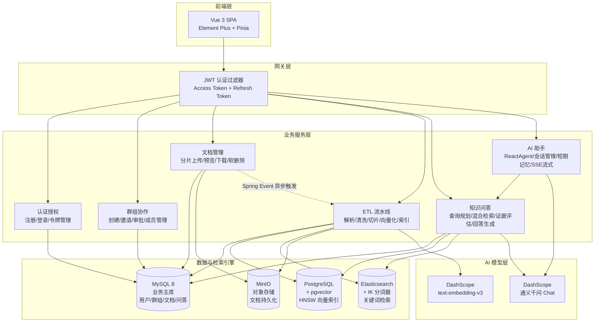

<div align="center">

<strong>简体中文</strong> | <a href="README_EN.md">English</a>

<br/>
<br/>


</div>

<br/>

<h1 align="center">
  <picture>
    <source media="(prefers-color-scheme: dark)" srcset="https://img.shields.io/badge/Argus-RAG_知识库平台-4A90D9?style=for-the-badge&logo=data:image/svg+xml;base64,PHN2ZyB3aWR0aD0iMjQiIGhlaWdodD0iMjQiIHZpZXdCb3g9IjAgMCAyNCAyNCIgZmlsbD0ibm9uZSI+PGNpcmNsZSBjeD0iMTIiIGN5PSIxMiIgcj0iOSIgc3Ryb2tlPSJ3aGl0ZSIgc3Ryb2tlLXdpZHRoPSIxLjUiLz48Y2lyY2xlIGN4PSIxMiIgY3k9IjEyIiByPSI0IiBzdHJva2U9IndoaXRlIiBzdHJva2Utd2lkdGg9IjEuNSIvPjwvc3ZnPg==&logoColor=white&labelColor=2a6cb6"/>
    
  </picture>
</h1>

<p align="center">
  <strong>融合 RAG 与 AI Agent 技术的企业级智能知识平台</strong>
</p>

<p align="center">
  让每一次提问都有据可查 —— 文档上传 · 智能解析 · 混合检索 · AI 对话 · 引用溯源
</p>

<p align="center">
  <a href="#-核心亮点">核心亮点</a> ·
  <a href="#-质量基线">质量基线</a> ·
  <a href="#-系统架构">系统架构</a> ·
  <a href="#-功能模块">功能模块</a> ·
  <a href="#-技术栈">技术栈</a> ·
  <a href="#-快速开始">快速开始</a> ·
  <a href="#-api-概览">API 概览</a> ·
  <a href="#-项目结构">项目结构</a>
</p>

<br/>

---

## ✨ 为什么选择 Argus？

> **Argus**（百眼巨人）—— 在希腊神话中，Argus 拥有一百只眼睛，即使睡着也有眼睛保持警惕。我们以此命名，寓意平台如同百眼巨人一般，全面洞察你的私有知识资产，**让每一次提问都有据可查**。

**Argus** 不是另一个"套壳 ChatGPT"。它是一个从底层构建的 **RAG（检索增强生成）知识库平台**，将企业私有文档与大语言模型深度融合，解决 LLM 在垂直领域应用中的三大核心痛点：

| 痛点 | Argus 的解决方案 |
|------|-----------------|
| 🔮 **幻觉编造** | 混合检索 + 证据评估 + 结构化输出，确保回答基于真实文档，无法回答时主动拒答 |
| 📚 **知识割裂** | 自动文档解析 → 切片 → 向量化 → 索引，打通从文件到知识的全链路 |
| 🧠 **无记忆对话** | ReactAgent + 三级短期记忆压缩，支持跨轮次的上下文感知对话 |

<br/>

## 🔥 核心亮点

<table>
<tr>
<td width="50%">

### 🎯 RAG 全链路闭环

从文档上传到 AI 回答，构建了完整的 **RAG 流水线**：

```
文档上传 → 智能解析 → 文本切片
    ↓
向量嵌入（PGvector HNSW） + 关键词索引（Elasticsearch IK）
    ↓
用户提问 → 查询规划（LLM） → 混合检索（RRF 融合）
    ↓
证据评估（四级充分度） → LLM 生成 → 引用溯源
```

**不是简单的"搜索 + GPT 包装"**，而是自研了查询规划、RRF 融合排序、四级证据评估等关键环节。

</td>
<td width="50%">

### 🤖 AI Agent 对话引擎

基于 **Spring AI Alibaba ReactAgent** 图执行引擎，支持：

- **双模式切换**：纯对话（CHAT）/ 知识库检索（KB_SEARCH），同一会话内动态切换
- **工具编排**：Agent 自主决定是否调用检索工具，每轮最多一次防止浪费
- **SSE 流式输出**：模型回复逐字推送到前端，零等待体验
- **短期记忆**：三级渐进压缩（会话记忆 → 紧凑摘要 → 运行时截断），在有限上下文窗口内维持长对话

</td>
</tr>
<tr>
<td width="50%">

### 🔍 混合检索架构

**向量语义检索 + 关键词全文检索** 双通道并行，RRF（Reciprocal Rank Fusion）融合排序：

- **语义匹配**：PGvector + HNSW 索引 + COSINE_DISTANCE，捕捉语义相似性
- **精确匹配**：Elasticsearch + IK 中文分词 + BM25，精准命中专业术语
- **证据增强**：类簇聚合 + 邻居窗口扩展，补充上下文避免碎片化

</td>
<td width="50%">

### 🛡️ 企业级安全体系

- **两级正交角色**：系统级 `ADMIN / USER`（管理员仅限运维区）· 群组级 `OWNER / MEMBER`
- **JWT 双令牌**：Access Token（30min）+ Refresh Token（14d，httpOnly Cookie + 数据库 Rotation）
- **BCrypt 密码加密** + 强制修改密码
- **群组数据隔离**：向量检索和 ES 检索均附加 `groupId` 过滤，服务端统一校验，**18/18 越权用例全部拦截**
- **AOP 操作日志**：关键操作全程留痕 + 慢 SQL 拦截器

</td>
</tr>
</table>

<br/>

## 📊 质量基线

> 平台的可信度不靠"感觉能用"。V5.0 二次开发引入**三套可复现的自动化验证**，用数据证明检索质量、权限安全与性能表现。

<table>
<tr>
<td width="33%" align="center">

### 🎯 RAG 检索质量
**56 条**受控评测集

| 指标 | 结果 |
|------|------|
| 检索命中率 | **100%** |
| MRR | **0.942** |
| 无答案拒答率 | **100%** |
| 权限泄漏率 | **0%** |
| 延迟 P95 | **3.72s** |

<sub>`python evaluation/run_eval.py eval`</sub>

</td>
<td width="33%" align="center">

### 🛡️ 权限越权测试
**18 条**越权用例

| 分组 | 结果 |
|------|------|
| 未认证访问 | 5/5 ✅ |
| 跨群组越权 | 9/9 ✅ |
| 资源伪造 | 3/3 ✅ |
| 角色越权 | 1/1 ✅ |

<sub>`python security/test_authz.py`</sub>

</td>
<td width="34%" align="center">

### ⚡ 性能与可观测性
**61 项** Actuator 指标

| 场景（C=30） | P95 | 错误 |
|------|------|------|
| 群组列表 | 138ms | 0 |
| 文档列表 | 150ms | 0 |
| 健康检查 | 101ms | 0 |

<sub>`python performance/load_test.py`</sub>

</td>
</tr>
</table>

**8 阶段工程化改造**：数据库迁移（PG → MySQL 业务库 + PG 向量库解耦）· ETL 可靠性（僵尸回收 / 重试 / 三端一致）· 质量评测 · 权限测试 · 可观测性 · Docker 部署 · 差异化功能（问答反馈闭环 / ETL 运维统计）。

> 📘 完整技术细节见 [`docs/V5.0-项目文档.md`](docs/V5.0-项目文档.md)

<br/>

## 🏗️ 系统架构



> **为什么是四套存储**：MySQL 承载全部业务数据，PostgreSQL 专注向量检索（HNSW + 余弦距离），Elasticsearch 负责中文关键词倒排，MinIO 存放原始文件。一次检索同时命中向量通道与关键词通道，由 RRF 融合排序。详见 [V5.0 项目文档 · 架构要点](docs/V5.0-项目文档.md#22-架构要点为什么用四套存储)。

<br/>

## 📦 功能模块

### 🔐 用户认证与群组协作

- 用户注册/登录、JWT 双令牌认证（Access 30min + Refresh 14d）
- **两级正交角色**：系统级 `ADMIN / USER`（管理员为运维角色，禁止进入业务区）· 群组级 `OWNER / MEMBER`（每群独立）
- 创建知识库群组、邀请成员、加入申请与审批流程
- **服务端统一鉴权**：`requireGroupReadable`（成员可读）/ `requireGroupOwner`（群主可写），跨群访问一律拒绝，不依赖前端隐藏按钮

### 📄 文档全生命周期管理

- **分片上传协议**：三阶段（init → chunk upload → complete），支持断点续传、秒传检测（SHA-256）
- **多格式解析**：PDF / DOCX / MD / TXT，自动编码检测
- **ETL 异步流水线**：Spring Event + `@Async` + `@Retryable`，7 步全自动处理
- **对象存储**：MinIO S3 兼容存储，`@ConditionalOnProperty` 按需启用

### 🧠 知识库问答（RAG Q&A）

- **LLM 查询规划**：自动判断 DIRECT / REWRITE / DECOMPOSE 策略，最多 3 条并行检索
- **RRF 双通道融合**：向量 + 关键词结果统一排序，类簇聚合 + 邻居窗口扩展
- **四级证据评估**：NONE → WEAK → PARTIAL → SUFFICIENT，证据不足时主动拒答
- **引用溯源**：每条回答附带引用片段、来源文档、相关性评分

### 🤖 AI 智能助手

- **ReactAgent 图执行引擎**："思考 → 工具调用 → 生成回复"完整链路
- **CHAT / KB_SEARCH 双模式**：纯对话 or 知识库检索，同一会话内动态切换
- **BEFORE_MODEL Hook**：模型调用前自动注入上下文（compact summary → session memory → recent messages）
- **短期记忆三级压缩**：
  - L1 会话记忆（增量 LLM 摘要，保留关键事实和决策）
  - L2 紧凑摘要（精炼的历史压缩，丢弃冗余细节）
  - L3 运行时截断（Token 超 50000 时的最后防线）
- **SSE 流式输出**：Delta 去重 + AGENT_MODEL_FINISHED 兜底

<br/>

## 🛠️ 技术栈

### 后端核心

| 层次 | 技术 | 版本 | 说明 |
|------|------|------|------|
| 语言 | **Java** | 21 | Record 语法、虚拟线程、模式匹配 |
| 框架 | **Spring Boot** | 3.5.0 | Spring MVC，Jakarta EE 9+ |
| ORM | **MyBatis-Plus** | 3.5.15 | Lambda 类型安全查询 + XML 复杂查询 |
| 业务数据库 | **MySQL** | 8.0 | 用户 / 群组 / 文档 / 分片文本 / 问答记录（18 张表） |
| 向量数据库 | **PostgreSQL + pgvector** | 16+ | HNSW 向量索引，COSINE_DISTANCE，512 维 |
| 搜索引擎 | **Elasticsearch** | 8.x | IK 中文分词，JDK HttpClient 直连 |
| 对象存储 | **MinIO** | latest | S3 兼容，`composeObject` 合并分片 |
| AI Chat | **Spring AI Alibaba** | 1.1.2.0 | DashScope 原生集成（通义千问） |
| AI Agent | **Spring AI Alibaba Agent** | 1.1.2.0 | ReactAgent 图执行引擎 |
| AI Embedding | **Spring AI** | 1.1.2 | OpenAI 兼容模式，512 维向量 |
| 认证 | **JJWT** | 0.12.6 | HMAC-SHA256 JWT 签发与解析 |
| 密码加密 | **Spring Security Crypto** | — | BCrypt 自适应哈希 |
| 文档解析 | **Apache PDFBox / POI** | 2.0.31 / 5.2.5 | PDF + DOCX 文本提取 |
| 重试框架 | **Spring Retry** | — | `@Retryable` + `@Recover` 声明式重试 |
| API 文档 | **Knife4j + SpringDoc** | 4.5.0 | `/doc.html` 增强 UI，在线调试 |

### 前端核心

| 层次 | 技术 | 版本 |
|------|------|------|
| 语言 | **TypeScript** | 6.0 |
| 框架 | **Vue 3** (Composition API) | 3.5 |
| 构建 | **Vite** | 8.0 |
| 路由 | **Vue Router** | 5.0 |
| 状态管理 | **Pinia** | 3.0 |
| UI 组件 | **Element Plus** | 2.14 |
| HTTP 客户端 | **Axios** | 1.16 |
| Markdown | **marked** | 18.0 |

### 基础设施

| 组件 | 用途 |
|------|------|
| **MySQL 8.0** | 业务主存储：用户、群组、文档元数据、分片文本、问答记录与反馈（18 张表） |
| **PostgreSQL 16 + pgvector** | 向量存储：HNSW 索引（512 维，COSINE_DISTANCE） |
| **Elasticsearch 8.x** | IK 中文分词 + BM25 关键词检索 + 两阶段 bool/rescore 打分 |
| **MinIO** | S3 兼容对象存储，分片合并（composeObject），条件装配 |
| **DashScope** | 通义千问 Chat 模型 + text-embedding-v3 Embedding 模型 |

<br/>

## 🚀 快速开始

### 环境要求

| 组件 | 版本要求 | 说明 |
|------|---------|------|
| **JDK** | 21 | Record 语法、虚拟线程 |
| **Node.js** | ≥ 20.19 | 前端构建 |
| **MySQL** | 8.0+ | 业务主库（18 张表） |
| **PostgreSQL** | 16+ | 向量库，需安装 `pgvector` 扩展 |
| **Elasticsearch** | 8.x | 需安装 IK 中文分词器插件 |
| **MinIO** | latest | 对象存储 |
| **DashScope API Key** | — | LLM Chat + Embedding 共用 |

### 方式一：Docker Compose 一键启动（推荐）

`deploy/docker-compose.yml` 编排了完整五件套（MySQL + PostgreSQL/pgvector + MinIO + ES/IK + 后端）：

```bash
cd deploy
cp .env.example .env          # 填入密钥（数据库密码、JWT 密钥、DashScope Key）
docker compose up -d          # 启动全部服务，含健康检查与建表脚本自动执行

# 前端单独启动
cd ../Argus-frontend && npm install && npm run dev
```

> 部署细节见 [`deploy/README-部署指南.md`](deploy/README-部署指南.md)。

### 方式二：本地手动部署

#### 1️⃣ 初始化中间件

<details>
<summary><b>MySQL 8.0（业务主库）</b></summary>

```bash
# 执行建表脚本（18 张表 + 索引 + 外键）
mysql -h 127.0.0.1 -u root -p < sql/schema-mysql.sql
```
</details>

<details>
<summary><b>PostgreSQL + pgvector（向量库）</b></summary>

```bash
# 安装 pgvector 扩展
psql -h <host> -U <user> -d argus_rag_vector -c "CREATE EXTENSION IF NOT EXISTS vector;"

# 执行向量表建表脚本
psql -h <host> -U <user> -d argus_rag_vector -f sql/schema-pgvector.sql
```
</details>

<details>
<summary><b>MinIO（Docker）</b></summary>

```bash
docker run -d --name minio \
  -p 9000:9000 -p 9001:9001 \
  -e MINIO_ROOT_USER=minioadmin \
  -e MINIO_ROOT_PASSWORD=minioadmin \
  minio/minio server /data --console-address ":9001"

# 访问 http://localhost:9001 创建 Bucket（默认：argus-rag-documents）
```
</details>

<details>
<summary><b>Elasticsearch + IK 分词器</b></summary>

```bash
docker run -d --name elasticsearch \
  -p 9200:9200 -p 9300:9300 \
  -e "discovery.type=single-node" \
  -e "xpack.security.enabled=false" \
  elasticsearch:8.x

# 安装 IK 分词器
docker exec -it elasticsearch bin/elasticsearch-plugin install \
  https://github.com/medcl/elasticsearch-analysis-ik/releases/download/v8.x/elasticsearch-analysis-ik-8.x.zip
docker restart elasticsearch
```
</details>

#### 2️⃣ 配置环境

编辑 `Argus-backend/src/main/resources/application-local.yml`（该文件已 gitignore，密钥不会入库），或直接使用环境变量：

```yaml
# 业务主库（MySQL）
spring.datasource.url: jdbc:mysql://localhost:3306/argus_rag
spring.datasource.username: your_username
spring.datasource.password: your_password

# 向量库（PostgreSQL + pgvector）
argus.vector.datasource.url: jdbc:postgresql://localhost:5432/argus_rag_vector
argus.vector.datasource.username: your_username
argus.vector.datasource.password: your_password

# LLM（Chat 与 Embedding 共用同一个 DashScope Key）
spring.ai.dashscope.api-key: ${DASHSCOPE_API_KEY}
spring.ai.openai.api-key: ${DASHSCOPE_API_KEY}

# 对象存储
storage.minio.endpoint: http://localhost:9000
storage.minio.access-key: your_access_key
storage.minio.secret-key: your_secret_key

# Elasticsearch
elasticsearch.host: localhost
elasticsearch.port: 9200

# JWT 签名密钥（生产环境必须替换，长度 ≥ 32 字节）
argus.rag.auth.jwt-secret: ${ARGUS_RAG_JWT_SECRET}
```

> 完整的变量清单以 [`deploy/.env.example`](deploy/.env.example) 为准。

#### 3️⃣ 启动后端

```bash
# 设置 JDK 21
export JAVA_HOME="/path/to/jdk-21"

cd Argus-backend

# 编译
./mvnw clean compile

# 启动（默认 local 环境，端口 10001）
./mvnw spring-boot:run

# API 文档：http://localhost:10001/doc.html
```

#### 4️⃣ 启动前端

```bash
cd Argus-frontend

npm install
npm run dev

# 访问：http://localhost:5173
```

#### 🔑 默认账户

开发环境（`--spring.profiles.active=dev`）由 `DevAdminInitializer` 自动创建系统管理员账户，账号信息取自以下环境变量（**首次启动前务必修改默认占位值**）：

| 环境变量 | 说明 |
|---------|------|
| `ARGUS_RAG_DEV_ADMIN_USERNAME` | 管理员登录名 |
| `ARGUS_RAG_DEV_ADMIN_PASSWORD` | 管理员密码 |
| `ARGUS_RAG_DEV_ADMIN_EMAIL` | 管理员邮箱 |
| `ARGUS_RAG_DEV_ADMIN_DISPLAY_NAME` | 显示名称 |

> ⚠️ **系统管理员（`ADMIN`）仅用于运维接口（`/api/admin/**`）**，会被 `requireBusinessUser()` 挡在普通业务区之外。进行文档上传、问答等业务操作，请另建 `USER` 角色账号。

<br/>

## 📡 API 概览

### 认证 · `/api/auth`

| 方法 | 路径 | 说明 |
|------|------|------|
| POST | `/api/auth/register` | 用户注册 |
| POST | `/api/auth/login` | 用户登录（返回 Access + Refresh Token） |
| POST | `/api/auth/refresh` | 刷新令牌（Cookie 中的 Refresh Token） |
| POST | `/api/auth/logout` | 登出（清除 Refresh Token） |
| GET | `/api/auth/me` | 获取当前用户信息 |

### 群组协作 · `/api/groups`

| 方法 | 路径 | 说明 |
|------|------|------|
| POST | `/api/groups` | 创建群组 |
| GET | `/api/groups/my` | 查询我可见的群组（自己创建的 / 已加入的 / 待处理邀请） |
| GET | `/api/groups/{id}/members` | 群组成员列表 |
| DELETE | `/api/groups/{id}/members/{userId}` | 移除成员（OWNER） |
| POST | `/api/groups/{id}/leave` | 退出群组 |
| POST | `/api/groups/{id}/invitations` | 创建邀请（OWNER） |
| POST | `/api/invitations/{id}/accept` | 接受邀请 |
| POST | `/api/invitations/{id}/reject` | 拒绝邀请 |
| POST | `/api/groups/join-requests` | 申请加入群组 |
| GET | `/api/groups/{id}/join-requests` | 查看加入申请（OWNER） |
| POST | `/api/groups/{id}/join-requests/{requestId}/approve` | 审批通过（OWNER） |

### 文档管理 · `/api/documents`

| 方法 | 路径 | 说明 |
|------|------|------|
| POST | `/api/documents/upload/init` | 初始化分片上传（秒传/续传检测） |
| POST | `/api/documents/upload/chunks` | 上传分片 |
| POST | `/api/documents/upload/{id}/complete` | 完成上传，触发 ETL |
| POST | `/api/documents/upload` | 小文件直接上传（≤10MB） |
| GET | `/api/documents` | 文档列表（多条件筛选） |
| GET | `/api/documents/{id}/preview` | 预览文档 |
| GET | `/api/documents/{id}/download` | 下载文档 |
| DELETE | `/api/documents/{id}` | 软删除文档（三端清理：MySQL / PG / ES） |
| POST | `/api/documents/{id}/retry-ingestion` | 重试失败的 ETL 任务 |

### 知识库问答 · `/api/qa`

| 方法 | 路径 | 说明 |
|------|------|------|
| POST | `/api/qa/ask` | 提交问题，获取 AI 回答 + 引用溯源 |
| POST | `/api/qa/stream-ask` | SSE 流式问答（事件：`token` / `citations` / `error`） |

> ⚠️ 这两个接口**直接返回业务对象、不经 `ApiResponse` 包装**，前端需做差异化处理。

<details>
<summary><b>📋 请求/响应示例</b></summary>

**请求**：
```json
{
    "groupId": 1,
    "question": "文档上传流程是什么？上传失败后如何重试？"
}
```

**响应**：
```json
{
    "answered": true,
    "answer": "文档上传流程分为三个阶段：初始化、分片上传、完成合并。首先调用 /upload/init 初始化会话...",
    "citations": [
        {
            "documentId": 1,
            "chunkId": 15,
            "fileName": "Argus使用手册.pdf",
            "score": 0.97
        }
    ]
}
```
</details>

### 问答记录与反馈 · `/api/qa/records`

| 方法 | 路径 | 说明 |
|------|------|------|
| GET | `/api/qa/records` | 问答历史（分页） |
| GET | `/api/qa/records/{id}` | 记录详情（含引用快照） |
| DELETE | `/api/qa/records/{id}` | 删除记录 |
| PUT | `/api/qa/records/{id}/feedback` | 提交 / 更新反馈（点赞、点踩原因，幂等） |
| GET | `/api/qa/records/{id}/feedback` | 查询反馈 |
| DELETE | `/api/qa/records/{id}/feedback` | 取消反馈 |
| GET | `/api/qa/records/feedback/stats?groupId=` | 群维度反馈统计（含点踩原因分布） |

### 运维监控 · `/api/admin`

| 方法 | 路径 | 权限 |
|------|------|------|
| GET | `/api/admin/etl/stats?groupId=` | ADMIN（任务状态分布 / 近 7 天耗时 / 最近失败） |
| GET | `/api/admin/metrics/overview` | ADMIN（用量总览） |
| GET | `/api/admin/metrics/platform` | ADMIN（平台维度） |
| GET | `/api/admin/metrics/user/{userId}` | ADMIN |
| GET | `/api/admin/metrics/group/{groupId}` | ADMIN |
| GET | `/api/admin/metrics/trend` | ADMIN |
| GET | `/api/admin/metrics/rank/users` · `/rank/groups` | ADMIN |
| GET | `/actuator/health` · `/actuator/metrics` | 公开（61 项指标） |

### AI 助手 · `/api/assistant`

| 方法 | 路径 | 说明 |
|------|------|------|
| POST | `/api/assistant/sessions` | 创建新会话 |
| GET | `/api/assistant/sessions` | 会话列表 |
| PATCH | `/api/assistant/sessions/{id}` | 重命名会话 |
| DELETE | `/api/assistant/sessions/{id}` | 删除会话 |
| POST | `/api/assistant/chat` | 同步聊天（CHAT / KB_SEARCH） |
| POST | `/api/assistant/chat/stream` | 流式聊天（SSE，逐字推送） |
| GET | `/api/assistant/sessions/{id}/context` | 获取会话上下文（含摘要） |

<br/>

## 📁 项目结构

```
Argus/
├── Argus-backend/                          # Spring Boot 后端
│   └── src/main/java/com/argus/rag/
│       ├── auth/                           # 认证授权（JWT 双令牌）
│       ├── user/                           # 用户管理
│       ├── group/                          # 群组协作（邀请/审批/角色）
│       ├── document/                       # 文档管理（分片上传/预览/下载）
│       │   └── scheduler/                  #   僵尸任务回收定时器
│       ├── ingestion/                      # ETL 流水线（解析/切片/向量化/索引）
│       │   └── service/pipeline/
│       │       ├── reader/                 #   文档读取器
│       │       ├── parser/                 #   多格式解析器（PDF/DOCX/MD/TXT）
│       │       └── transformer/            #   文本清洗 + 结构感知切片
│       ├── qa/                             # 知识库问答（查询规划/RRF 融合/证据评估）
│       │   └── rag/                        #   混合检索引擎
│       ├── assistant/                      # AI 助手（ReactAgent/短期记忆/SSE 流式）
│       │   ├── agent/                      #   Agent 工厂 + 知识库检索工具
│       │   ├── memory/                     #   三级短期记忆压缩
│       │   └── service/                    #   对话编排 + 会话管理
│       ├── metrics/                        # 用量计量与运维指标
│       ├── common/                         # 共享设施（统一响应/异常/枚举/日志切面/双数据源）
│       └── engine/                         # 基础设施（ES/PGvector/MinIO/You.com）
│
├── Argus-frontend/                         # Vue 3 前端
│   └── src/
│       ├── api/                            # 后端 API 封装
│       ├── views/                          # 页面组件
│       │   ├── HomeView.vue                #   产品首页
│       │   ├── documents/                  #   文档管理
│       │   ├── qa/                         #   知识库问答
│       │   ├── assistant/                  #   AI 助手
│       │   ├── groups/                     #   协作小组
│       │   └── admin/                      #   用户管理
│       ├── stores/                         # Pinia 状态管理
│       └── components/                     # 公共组件
│
├── deploy/                                 # 部署资产
│   ├── docker-compose.yml                  #   五件套编排（MySQL/PG/MinIO/ES/后端）
│   ├── Dockerfile                          #   后端镜像
│   ├── elasticsearch/Dockerfile.es         #   含 IK 分词器的 ES 镜像
│   ├── .env.example                        #   环境变量模板
│   └── start-local-windows.bat             #   Windows 本地一键启动
│
├── evaluation/                             # RAG 质量评测
│   ├── eval_docs/                          #   受控语料（8 公开 + 2 机密）
│   ├── rag-eval-set.json                   #   56 条问题集
│   ├── run_eval.py                         #   评测脚本（setup / eval）
│   └── results/                            #   历史评测结果
│
├── performance/                            # 性能压测
├── security/                               # 权限越权自动化测试
│
├── docs/                                   # 项目文档
│   ├── V5.0-项目文档.md                    #   ⭐ 当前完整技术文档（推荐阅读）
│   ├── V1.0-项目文档.md                    #   用户认证 + 群组管理
│   ├── V2.0-项目文档.md                    #   文档上传 + ETL 流水线
│   ├── V3.0-项目文档.md                    #   知识库问答（RAG）
│   ├── V4.1-项目文档.md                    #   AI 助手 Agent + 流式对话
│   └── 二次开发-阶段4/5/6/8-*.md           #   各阶段验证报告
│
└── sql/
    ├── schema-mysql.sql                    # MySQL 业务库建表（18 张表）
    ├── schema-pgvector.sql                 # PostgreSQL 向量库建表
    └── upgrade-qa-feedback.sql             # V5.0 增量升级脚本
```

<br/>

## 📖 版本演进

Argus 采用**渐进式迭代**的开发方式，每个版本聚焦一个核心主题：

| 版本 | 主题 | 核心交付 |
|------|------|---------|
| **V1.0** | 🏗️ 基础设施 | 用户认证（JWT 双令牌）、群组协作（邀请/审批/角色）、项目骨架 |
| **V2.0** | 📄 文档引擎 | 分片上传（断点续传/秒传）、ETL 流水线、双路检索（向量 + 关键词） |
| **V3.0** | 🧠 RAG 问答 | 查询规划（LLM）、RRF 融合排序、四级证据评估、引用溯源 |
| **V4.0 / V4.1** | 🤖 AI Agent | ReactAgent 图引擎、CHAT/KB_SEARCH 双模式、短期记忆三级压缩、SSE 流式、引用快照持久化 |
| **V5.0** | 🔧 工程化 | 业务库迁移 MySQL（与向量库解耦）、ETL 可靠性加固、RAG 质量评测基线、18 条越权测试、61 项可观测指标、Docker 部署、问答反馈闭环 |

> 详细的设计决策和技术文档请参阅 [`docs/`](docs/) 目录，**当前完整技术文档**：[`docs/V5.0-项目文档.md`](docs/V5.0-项目文档.md)。

<br/>

## 🤝 贡献

欢迎提交 Issue 和 Pull Request！

在提交 PR 之前，请确保：
- 代码通过编译（`./mvnw clean compile`）
- 遵循项目现有的代码风格和命名规范
- 新增功能包含相应的 JavaDoc 或注释

<br/>

## 📄 License

本项目采用 [MIT](LICENSE) 开源协议。

<br/>


---

<p align="center">
  <sub>Made with ❤️ by the Argus team · 让每一次提问都有据可查</sub>
</p>
