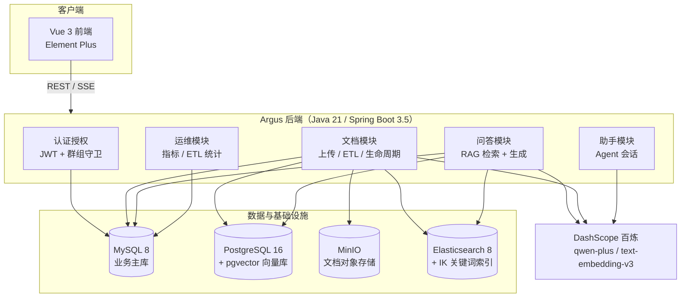
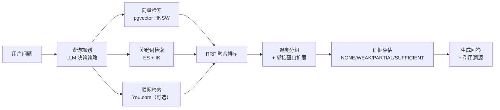
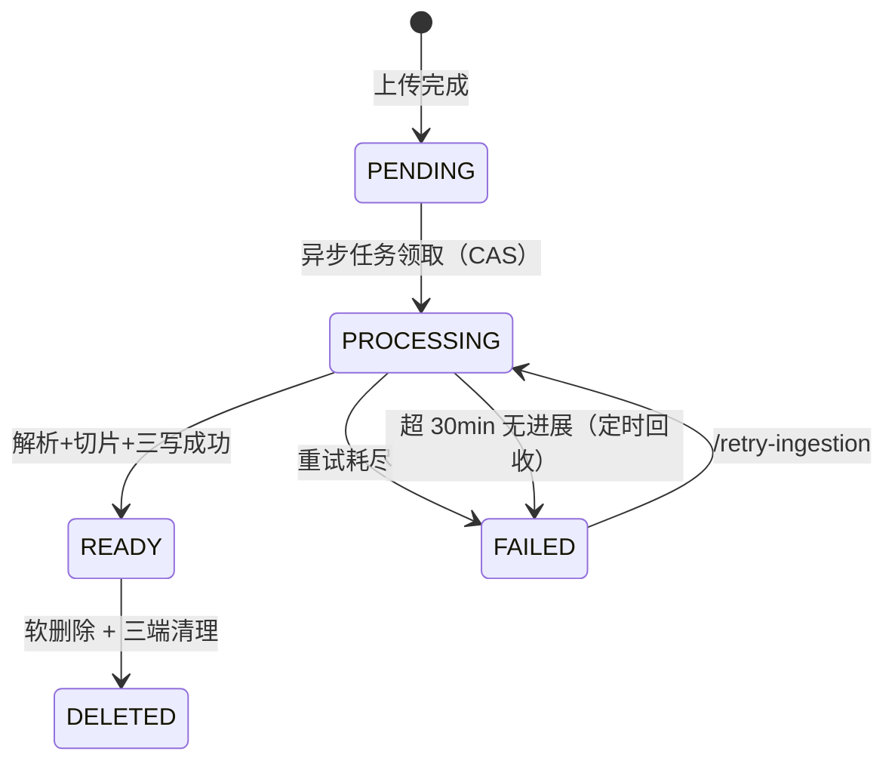

# Argus 企业级 RAG 智能知识库平台 · 项目文档 V5.0

> 文档版本：V5.0
> 更新日期：2026-10-11
> 覆盖范围：原始平台源码 + 二次开发 8 阶段全部成果
> 关联文档：[二次开发技术方案](./二次开发技术方案.md) · [阶段 4 RAG 评测基线](./二次开发-阶段4-RAG评测基线.md) · [阶段 5 权限越权测试报告](./二次开发-阶段5-权限越权测试报告.md) · [阶段 6 性能与可观测性报告](./二次开发-阶段6-性能与可观测性报告.md) · [阶段 8 差异化功能说明](./二次开发-阶段8-差异化功能说明.md)

---

## 目录

1. [项目概述](#一项目概述)
2. [系统架构](#二系统架构)
3. [技术栈](#三技术栈)
4. [项目结构](#四项目结构)
5. [核心设计](#五核心设计)
6. [数据模型](#六数据模型)
7. [API 接口清单](#七api-接口清单)
8. [关键配置](#八关键配置)
9. [部署与运行](#九部署与运行)
10. [质量验证](#十质量验证)
11. [二次开发成果](#十一二次开发成果)
12. [已知问题与技术债](#十二已知问题与技术债)
13. [后续规划](#十三后续规划)
14. [附录](#十四附录)

---

## 一、项目概述

### 1.1 定位

Argus 是一个**企业级智能知识库平台**，核心能力是把团队分散的文档转化为可智能问答的知识资产。它不是一个"接个大模型就能聊天"的 Demo，而是一套完整的 B/S 架构系统，具备：

- **文档全生命周期管理**：分片上传 → 秒传去重 → 解析切片 → 向量化 → 检索就绪 → 软删除
- **RAG 全链路闭环**：查询规划 → 混合检索 → RRF 融合 → 证据评估 → 生成回答 → 引用溯源
- **企业级权限隔离**：以群组为边界的多租户知识库，服务端统一鉴权
- **AI Agent 对话引擎**：支持会话上下文与流式输出的智能助手
- **可运营能力**：问答反馈闭环、ETL 运维统计、Token 用量计量

### 1.2 关键指标（截至 V5.0）

| 指标 | 数值 | 说明 |
|---|---|---|
| 后端代码规模 | 219 个 Java 文件 / 19,315 行 | `Argus-backend/src/main/java` |
| 前端代码规模 | 60 个文件 / 20,063 行 | `.vue` + `.ts` |
| 验证脚本规模 | 656 行 Python | `evaluation/` `performance/` `security/` |
| 业务数据表 | 18 张（MySQL）+ 1 张（PG） | 见第六章 |
| REST 接口 | 61 个 | 覆盖认证、群组、文档、问答、助手、运维 |
| RAG 检索命中率 | **100%** | 56 条评测集，46 条可回答 |
| MRR | **0.942** | 检索排序质量 |
| 权限泄漏率 | **0%** | 跨群机密文档零泄漏 |
| 无答案拒答率 | **100%** | 无幻觉作答 |
| 问答延迟 | P50 1.89s / P95 3.72s | 本机单并发 |
| 业务查询吞吐 | P95 < 150ms（C=30） | 压测基线，零错误 |
| 越权测试 | 18/18 通过 | 未认证 / 跨群 / 伪造 ID / 角色 |

### 1.3 版本沿革

| 版本 | 主题 | 说明 |
|---|---|---|
| V1.0 ~ V4.1 | 平台原始迭代 | 见 `docs/V1.0-项目文档.md` ~ `docs/V4.1-项目文档.md` |
| **V5.0（本文档）** | **二次开发** | 8 阶段改造：数据库迁移、ETL 可靠性、质量验证、可观测性、部署、差异化功能 |

二次开发的核心命题：**把平台从"功能可用"推到"工程可信"**——用可量化的评测证明检索质量，用可复现的测试证明权限安全，用可观测的指标证明性能达标。

---

## 二、系统架构

### 2.1 整体架构



### 2.2 架构要点：为什么用四套存储

这是本项目最容易被误解的设计。**四套存储不是重复建设，而是各司其职**：

| 存储 | 承担的职责 | 不承担的职责 |
|---|---|---|
| MySQL 8 | 全部业务数据：用户、群组、文档元数据、分片文本、问答记录 | 不做向量检索 |
| PostgreSQL 16 + pgvector | 分片 embedding 向量的 HNSW 索引与相似度检索 | 不存业务数据 |
| MinIO | 原始文档文件（对象存储，支持预签名） | 不做索引 |
| Elasticsearch 8 + IK | 中文关键词倒排索引（BM25） | 不做向量检索 |

**为什么向量库不放在 MySQL**：MySQL 缺乏生产级的向量索引与距离算子，pgvector 的 HNSW + 余弦距离是成熟方案。
**为什么要从 PostgreSQL 迁到 MySQL**：原始平台业务库与向量库都放在 PG 里，职责耦合；二次开发实施**路线 B**——业务库迁 MySQL、向量库保留 PG，实现业务与向量解耦（MySQL 的运维生态更普及，PG 则专注向量特长）。

### 2.3 分层结构

```
Controller 层   ← 参数校验（@Valid）、统一响应 ApiResponse、SSE 输出
    ↓
Service 层      ← 业务编排、权限守卫（requireGroupReadable/Owner）、事务边界、状态机
    ↓
Mapper 层       ← MyBatis-Plus BaseMapper + XML（复杂查询、FOR UPDATE 行锁）
    ↓
Engine 层       ← pgvector 检索适配、ES 索引、MinIO 存储、外部搜索
```

**约定**：业务数据访问一律走 MyBatis-Plus（`BaseMapper` / `LambdaQueryWrapper` / XML），**不写裸 SQL**；`JdbcTemplate` 仅出现在 `engine/pgvector/VectorStoreConfiguration.java` 中，供 Spring AI PgVectorStore 装配使用，不承担业务查询。异常统一抛 `BusinessException` / `ForbiddenException` / `UnauthorizedException`，由 `GlobalExceptionHandler` 映射为 HTTP 状态码。

---

## 三、技术栈

### 3.1 后端

| 分类 | 技术 | 版本 | 用途 |
|---|---|---|---|
| 语言 | Java | 21 | record 语法、虚拟线程可用 |
| 框架 | Spring Boot | 3.5.0 | Web MVC（非 WebFlux）、Validation、AOP、Actuator |
| ORM | MyBatis-Plus | 3.5.15 | `BaseMapper` + `LambdaQueryWrapper` + XML 混合 |
| 数据库驱动 | mysql-connector-j | — | 业务主库 |
| 数据库驱动 | postgresql | — | 向量库 |
| AI | Spring AI Alibaba | 1.1.2.0 | DashScope 模型接入、Agent 框架 |
| AI | Spring AI BOM | 1.1.2 | OpenAI 兼容 embedding、pgvector VectorStore |
| 文档解析 | Apache PDFBox | 2.0.31 | PDF 文本抽取 |
| 文档解析 | Apache POI OOXML | 5.2.5 | DOCX 文本抽取 |
| 对象存储 | MinIO SDK | — | 分片上传、预签名 URL |
| 认证 | JJWT | 0.12.6 | access token 签发与校验 |
| 加密 | spring-security-crypto | — | BCrypt 密码哈希 |
| 接口文档 | Knife4j + springdoc-openapi | 4.5.0 / 2.8.10 | Swagger UI（`/doc.html`） |
| 可观测性 | Spring Boot Actuator + Micrometer | — | 61 项运行指标 |
| 日志 | Logback | — | `logback-spring.xml` 分环境配置 |
| 构建 | Maven Wrapper | — | `./mvnw` 免装 Maven |

### 3.2 前端

| 分类 | 技术 | 版本 |
|---|---|---|
| 框架 | Vue | 3.5 |
| 语言 | TypeScript | 6.0 |
| 构建 | Vite | 8.0 |
| 状态管理 | Pinia | 3.0 |
| 路由 | Vue Router | 5.0 |
| UI 组件 | Element Plus | 2.14 |
| HTTP | axios | 1.16 |
| Markdown | marked | 18.0 |
| 质量 | ESLint 10 + oxlint + Prettier 3.8 + vue-tsc | — |
| 运行时 | Node.js | ^20.19 或 >=22.12 |

### 3.3 AI 模型

| 用途 | 模型 | 接入方式 | 关键参数 |
|---|---|---|---|
| 对话生成 | `qwen-plus` | Spring AI Alibaba DashScope 原生 | 温度等由 `QaChatClientConfiguration` 装配 |
| 向量化 | `text-embedding-v3` | OpenAI 兼容模式（`compatible-mode`） | **512 维**、`truncate: true` |
| 查询规划 | `qwen-plus` | 同对话模型 | 输出结构见 `QueryPlanResult` |
| 联网搜索（可选） | You.com API | `engine/youcom/` | `youcom.search.enabled=false` 默认关闭 |

> **注意**：embedding 维度 512 是硬约束——与 pgvector 表结构、HNSW 索引强绑定。更换 embedding 模型必须同步重建向量表。

### 3.4 基础设施（开发机实际版本）

| 组件 | 版本 / 形态 |
|---|---|
| MySQL | 8.4（Windows 服务） |
| PostgreSQL | 16 + pgvector 扩展（便携版） |
| MinIO | `RELEASE.2025-04-22T22-12-26Z`（便携版 exe） |
| Elasticsearch | 8.14.3 + analysis-ik 分词器（便携版，512m 堆，单节点，关闭安全） |

---

## 四、项目结构

### 4.1 顶层目录

```
Argus-master/
├── Argus-backend/          # Spring Boot 后端
├── Argus-frontend/         # Vue 3 前端
├── deploy/                 # 部署资产（Dockerfile / compose / 启动脚本）
├── docs/                   # 项目文档（版本化 + 二次开发阶段报告）
├── evaluation/             # RAG 质量评测（语料 / 问题集 / 脚本 / 结果）
├── performance/            # 性能压测脚本
├── security/               # 权限越权测试脚本
├── sql/                    # 数据库脚本（MySQL / PG / 升级脚本）
├── .workbuddy/memory/      # 开发过程工作记忆
├── AGENTS.md / CLAUDE.md   # 协作约定
└── README.md               # 快速开始
```

### 4.2 后端模块划分

```
com.argus.rag
├── ArgusBackendApplication.java    # 入口，@EnableScheduling
├── common/                         # 共享基础设施
│   ├── api/ApiResponse             # 统一响应 {success, data, message}
│   ├── config/                     # DataSourceConfiguration（双数据源）、OpenApiConfiguration
│   ├── enums/                      # 9 个业务枚举
│   ├── exception/                  # BusinessException / ForbiddenException / GlobalExceptionHandler
│   ├── log/                        # LogAop + @OperationLog（操作审计）、SlowSqlInterceptor（慢 SQL）
│   └── security/                   # AuthenticatedUser、UserContext
├── auth/                           # 认证：JWT 过滤器、Token 服务、刷新令牌、当前用户上下文
├── user/                           # 用户：账号、管理端用户管理
├── group/                          # 群组：成员关系、邀请、加入申请、权限守卫
├── document/                       # 文档：上传会话、秒传、生命周期、删除、回收调度器
│   └── scheduler/                  # StaleProcessingDocumentRecoveryScheduler（僵尸回收）
├── ingestion/                      # 摄入（ETL）：异步流水线、解析器、切片、向量化、运维统计
│   └── service/pipeline/parser/    # PdfDocumentParser、DocxDocumentParser
├── engine/                         # 检索引擎适配
│   ├── elasticsearch/              # ElasticsearchChunkIndexService（含索引就绪等待）
│   ├── pgvector/                   # PgVectorRetrievalAdapter、VectorStoreConfiguration
│   ├── storage/                    # MinioStorageService
│   └── youcom/                     # YoucomSearchService（可选联网检索）
├── qa/                             # 问答（RAG 核心）
│   ├── rag/                        # HybridChunkRetrievalService、QuestionQueryRewriteService、
│   │                               # ReadyChunkDocumentRetriever、RetrievedEvidenceBundle
│   ├── model/                      # EvidenceLevel、QueryPlanStrategy、KnowledgeAnswerOutput
│   ├── service/                    # QaService、QaChatService、QaFeedbackService、记录持久化/查询
│   └── controller/                 # QaController、QaRecordController、QaFeedbackController
├── assistant/                      # AI 助手：会话、上下文、Agent 门面
└── metrics/                        # 用量计量与运维指标
```

### 4.3 资源文件

```
src/main/resources/
├── application.yml              # 全局：profile=local、MyBatis-Plus、Actuator、慢 SQL 阈值
├── application-dev.yml          # 开发：数据源、模型、存储、检索引擎、切片参数
├── application-local.yml        # 本机：真实密钥（已 gitignore，不入库）
├── logback-spring.xml           # 日志分环境
└── mappers/                     # 15 个 MyBatis XML
    ├── DocumentMapper.xml / GroupMembershipMapper.xml / UserMapper.xml ...
    ├── document/                # 上传会话、上传分片
    ├── ingestion/               # 分片、摄入任务
    ├── qa/                      # 问答记录、引用
    ├── assistant/               # 会话、消息、上下文
    └── metrics/                 # LLM 用量记录
```

### 4.4 前端结构

```
Argus-frontend/src/
├── api/           # axios 接口封装
├── components/    # 通用组件
├── layouts/       # 布局
├── router/        # 路由
├── stores/        # Pinia
├── types/         # TS 类型
└── views/         # 页面
    ├── HomeView / LoginView / NotFoundView
    ├── admin/     # 管理端
    ├── assistant/ # 助手
    ├── documents/ # 文档
    ├── groups/    # 群组
    ├── qa/        # 问答
    └── settings/  # 设置
```

---

## 五、核心设计

### 5.1 RAG 检索链路

这是平台技术含量最高的部分，实现在 `qa/rag/HybridChunkRetrievalService.java`。



**1）查询规划（Query Planning）**——先让大模型决定检索策略：

| 策略 | 含义 | 适用场景 |
|---|---|---|
| `DIRECT` | 原问题直接检索 | 问题清晰明确 |
| `REWRITE` | 改写为检索友好形式，同时保留原问题 | 口语化提问 |
| `DECOMPOSE` | 拆分为多个子问题分别检索后合并 | 复合问题 |
| `GLOBAL` | 遍历知识库全部文档 | 统计、列表、全局总结 |

**2）三通道并行检索**——向量（语义）+ 关键词（精确）+ 联网（外部），单通道 `CHANNEL_TOP_K = 50`。

**3）RRF 融合（Reciprocal Rank Fusion）**——把多路排名合并为统一排序。
本项目取 `RRF_K = 0`（纯排名倒数融合，不做平滑），实现上通过 `mergeVectorHits` / `mergeKeywordHits` 对同一候选累加分数。

**4）聚类分组 + 邻接窗口扩展**——同一文档的相邻分片（`DEFAULT_NEIGHBOR_WINDOW = 1`）会被聚合扩展，避免切片切断语义；全局检索模式下上限 `MAX_GLOBAL_DOCUMENTS = 50`。

**5）证据分级**——决定"答还是拒"的关键闸门：

| 等级 | 含义 | 系统行为 |
|---|---|---|
| `NONE` | 无任何命中 | **直接拒答** |
| `WEAK` | 仅少量低相关命中 | 回答时必须声明依据有限 |
| `PARTIAL` | 部分覆盖问题 | 明确说明未覆盖部分 |
| `SUFFICIENT` | 多通道互证、评分高 | 正常回答 |

这是**拒答能力来自设计**而非运气——评测中 4 条无答案题 100% 正确拒答。

### 5.2 ETL 可靠性设计



三道可靠性防线：

1. **CAS 状态流转**——所有状态更新带旧值条件（`WHERE status = 旧值`），杜绝并发重复处理。
2. **指数退避重试**——失败后等待 2s → 4s → 8s，最多 3 次，仍失败则标记 `FAILED` 并记录原因（`failure_reason`）。
3. **定时僵尸回收**——`StaleProcessingDocumentRecoveryScheduler` 每 5 分钟（`fixedDelay`）扫描超 30 分钟无进展的 `PROCESSING` 文档，标记为 `FAILED`。启动时另有全量回收 Runner 复用同一服务。

**三写一致性**：一个分片同时写入 MySQL（文本）、PG（向量）、ES（关键词索引）。删除时三端同步清理（`DocumentDeleteService` 软删时调用 `documentChunkMapper.deleteByDocumentId`，失败仅告警不阻断）。

### 5.3 权限模型

**两层正交角色**，这是最容易混淆的地方：

| 层级 | 存储 | 取值 | 语义 |
|---|---|---|---|
| 系统级 | `users.system_role` | `ADMIN` / `USER` | 全局唯一。`ADMIN` 为运维角色，被 `requireBusinessUser()` **禁止进入普通业务区** |
| 群组级 | `group_memberships.role` | `OWNER` / `MEMBER` | 每群独立，同一用户在不同群可拥有不同角色 |

**服务端统一守卫**（不依赖前端隐藏按钮）：

- `requireGroupReadable(groupId)` → 非成员拒绝。调用点：列文档、预览、下载、问答、反馈统计、助手。
- `requireGroupOwner(groupId)` → 非群主拒绝。调用点：上传、删除、邀请、移除成员、审批加入申请。

**加入方式**：群主邀请（`group_invitations`）或 用户申请 + 群主审批（`group_join_requests`）。

### 5.4 双数据源装配

`common/config/DataSourceConfiguration.java` 手工装配 MySQL 与 PG 两个 `DataSource` / `JdbcTemplate`。

> **踩坑记录（重要）**：Spring 的 `@Primary` 优先级**高于** Bean 方法参数名匹配。若不显式加 `@Qualifier`，`vectorDataSource` 会拿到 MySQL 的配置属性——这是一个**静默 Bug**（不报错、连错库），只有通过 `pg_stat_activity` 才能发现。修复方式即所有向量相关 Bean 方法参数显式 `@Qualifier`。

### 5.5 上传链路

```
POST /api/documents/upload/init      # 创建上传会话，返回 uploadId
POST /api/documents/upload/chunks    # 分片上传（multipart）
GET  /api/documents/upload/{id}      # 查询已上传分片（断点续传）
POST /api/documents/upload/{id}/complete  # 合并 + 触发 ETL
POST /api/documents/upload           # 小文件一体化上传
```

- **秒传**：基于文件 SHA-256 哈希，同群组内已存在相同哈希则直接复用，不重复存储与向量化。
- **断点续传**：上传会话与分片持久化在 `document_upload_sessions` / `document_upload_chunks`。
- **分片哈希校验**：服务端逐片校验 SHA-256，防止传输损坏。

> **踩坑记录**：用 Python 写测试文件时 `open('w')` 会把 `\n` 转成 `\r\n`，导致 Python 侧算出的哈希与磁盘实际文件不一致。分片哈希必须对**磁盘文件**用 `sha256sum` 计算。

---

## 六、数据模型

### 6.1 MySQL 业务库（`argus_rag`，18 张表）

| 分组 | 表名 | 职责 |
|---|---|---|
| **用户与认证** | `users` | 用户主表（`system_role`、`status`、`must_change_password`） |
| | `user_refresh_tokens` | 刷新令牌（httpOnly cookie） |
| **群组与权限** | `argus_groups` | 群组（知识库）主表。**注意**：`groups` 是 MySQL 保留字，故改名 |
| | `group_memberships` | 成员关系，`(group_id, user_id)` 唯一，`role` = OWNER/MEMBER |
| | `group_invitations` | 邀请记录（PENDING/ACCEPTED/REFUSED/CANCELLED） |
| | `group_join_requests` | 加入申请（PENDING/APPROVED/REJECTED/CANCELLED） |
| **文档** | `documents` | 文档元数据（`storage_bucket`/`storage_object_key`、`status`、`failure_reason`、`deleted`） |
| | `document_upload_sessions` | 上传会话（断点续传） |
| | `document_upload_chunks` | 上传分片（含哈希） |
| | `document_chunks` | **分片文本**（ETL 产出，检索命中后取原文） |
| | `ingestion_jobs` | 摄入任务（类型、状态、耗时） |
| **问答** | `qa_records` | 问答记录（问题、答案、是否回答、证据等级） |
| | `qa_record_citations` | 引用快照（回答时的证据留痕） |
| | `qa_feedback` | **反馈闭环**（V5.0 新增，`uk_record_user` 保证幂等，含点踩原因） |
| **助手** | `assistant_sessions` | 助手会话 |
| | `assistant_messages` | 会话消息 |
| | `assistant_session_contexts` | 会话上下文（长期记忆） |
| **计量** | `llm_usage_records` | LLM/embedding Token 用量 |

### 6.2 PostgreSQL 向量库（`argus_rag_vector`，1 张表）

| 表名 | 说明 |
|---|---|
| `vector_store` | Spring AI PgVectorStore 标准表，512 维向量 + HNSW 索引 + 余弦距离 + 元数据 JSON |

### 6.3 迁移要点（PG → MySQL）

二次开发中最容易翻车的一环。静态扫描无法发现全部问题，**必须靠真实链路回归**：

| PG 写法 | MySQL 等价 | 本项目踩坑 |
|---|---|---|
| `BIGSERIAL` | `BIGINT AUTO_INCREMENT` | — |
| `JSONB` | `JSON` | **残留 2 处** `cast(? as jsonb)`，运行时报错才发现 |
| `BOOLEAN` | `TINYINT(1)` | — |
| `RETURNING id` | MyBatis-Plus `useGeneratedKeys` | — |
| `ON CONFLICT DO UPDATE SET` | `ON DUPLICATE KEY UPDATE` | **残留 2 处** 多字段 `set` 语法错误 |
| `groups`（表名） | `argus_groups` | MySQL 保留字 |

> **教训**：方言迁移的正则扫描只能覆盖常见模式，`ON DUPLICATE KEY UPDATE` 的多字段 `set` 写法与 `jsonb` 强转最容易漏。**唯一可靠的验证方式是跑通全链路。**

---

## 七、API 接口清单

约定：除 `/api/qa/ask`、`/api/qa/stream-ask` 外，均返回 `ApiResponse<T>` = `{ success, data, message }`。

### 7.1 认证 `/api/auth`

| 方法 | 路径 | 说明 |
|---|---|---|
| POST | `/api/auth/register` | 注册（字段 `username`） |
| POST | `/api/auth/login` | 登录（字段 `loginId`，返回 `data.accessToken`） |
| POST | `/api/auth/refresh` | 刷新令牌 |
| POST | `/api/auth/logout` | 登出 |
| GET | `/api/auth/me` | 当前用户信息 |

### 7.2 账号与用户 `/api/account` `/api/admin/users`

| 方法 | 路径 | 权限 |
|---|---|---|
| POST | `/api/account/change-password` | 登录用户 |
| GET | `/api/admin/users` | ADMIN |
| GET | `/api/admin/users/{userId}` | ADMIN |
| PATCH | `/api/admin/users/{userId}/status` | ADMIN |

### 7.3 群组 `/api/groups` `/api/invitations`

| 方法 | 路径 | 权限 |
|---|---|---|
| POST | `/api/groups` | 创建群组 |
| GET | `/api/groups/my` | **仅业务用户**（ADMIN 会被拒） |
| GET | `/api/groups/{groupId}/members` | 群成员 |
| DELETE | `/api/groups/{groupId}/members/{userId}` | OWNER |
| POST | `/api/groups/{groupId}/leave` | 成员 |
| POST | `/api/groups/{groupId}/invitations` | OWNER |
| GET | `/api/groups/invitations/my-sent` | 登录用户 |
| POST | `/api/invitations/{invitationId}/accept` | 被邀请人 |
| POST | `/api/invitations/{invitationId}/reject` | 被邀请人 |
| POST | `/api/invitations/{invitationId}/cancel` | 邀请人 |
| POST | `/api/groups/join-requests` | 申请加入 |
| GET | `/api/groups/join-requests/my` | 本人申请 |
| GET | `/api/groups/{groupId}/join-requests` | OWNER |
| POST | `/api/groups/{groupId}/join-requests/{requestId}/approve` | OWNER |
| POST | `/api/groups/{groupId}/join-requests/{requestId}/reject` | OWNER |

### 7.4 文档 `/api/documents`

| 方法 | 路径 | 权限 |
|---|---|---|
| POST | `/api/documents/upload/init` | OWNER |
| POST | `/api/documents/upload/chunks` | OWNER |
| GET | `/api/documents/upload/{uploadId}` | OWNER |
| POST | `/api/documents/upload/{uploadId}/complete` | OWNER |
| POST | `/api/documents/upload` | OWNER |
| GET | `/api/documents?groupId=` | 成员 |
| GET | `/api/documents/{documentId}/preview` | 成员 |
| GET | `/api/documents/{documentId}/download` | 成员 |
| DELETE | `/api/documents/{documentId}` | OWNER |
| POST | `/api/documents/{documentId}/retry-ingestion` | OWNER |

### 7.5 问答 `/api/qa`

| 方法 | 路径 | 说明 |
|---|---|---|
| POST | `/api/qa/ask` | 问答（**无 ApiResponse 包装**，直接返回 `AskQuestionResponse`） |
| POST | `/api/qa/stream-ask` | SSE 流式问答（事件类型：`token` / `citations` / `error`） |
| GET | `/api/qa/records` | 问答历史（分页） |
| GET | `/api/qa/records/{recordId}` | 记录详情 |
| DELETE | `/api/qa/records/{recordId}` | 删除记录 |
| PUT | `/api/qa/records/{recordId}/feedback` | **提交/更新反馈**（V5.0 新增，幂等） |
| GET | `/api/qa/records/{recordId}/feedback` | 查询反馈 |
| DELETE | `/api/qa/records/{recordId}/feedback` | 取消反馈 |
| GET | `/api/qa/records/feedback/stats?groupId=` | **群维度反馈统计**（含点踩原因分布） |

### 7.6 助手 `/api/assistant`

| 方法 | 路径 | 说明 |
|---|---|---|
| POST | `/api/assistant/chat` | 助手对话 |
| POST | `/api/assistant/chat/stream` | SSE 流式对话 |
| GET | `/api/assistant/sessions` | 会话列表 |
| POST | `/api/assistant/sessions` | 创建会话 |
| GET | `/api/assistant/sessions/{sessionId}` | 会话详情 |
| PATCH | `/api/assistant/sessions/{sessionId}` | 更新会话 |
| DELETE | `/api/assistant/sessions/{sessionId}` | 删除会话 |
| GET | `/api/assistant/sessions/{sessionId}/context` | 会话上下文 |

### 7.7 运维 `/api/admin`

| 方法 | 路径 | 权限 |
|---|---|---|
| GET | `/api/admin/metrics/overview` | ADMIN |
| GET | `/api/admin/metrics/platform` | ADMIN |
| GET | `/api/admin/metrics/user/{userId}` | ADMIN |
| GET | `/api/admin/metrics/group/{groupId}` | ADMIN |
| GET | `/api/admin/metrics/trend` | ADMIN |
| GET | `/api/admin/metrics/rank/users` | ADMIN |
| GET | `/api/admin/metrics/rank/groups` | ADMIN |
| GET | `/api/admin/etl/stats?groupId=` | **仅 ADMIN**（V5.0 新增：状态分布/近 7 天耗时/最近失败） |
| GET | `/actuator/health` | 公开 |
| GET | `/actuator/metrics` | 公开（61 项指标） |

---

## 八、关键配置

### 8.1 Profile

| Profile | 用途 | 密钥来源 |
|---|---|---|
| `local`（默认） | 本机开发 | `application-local.yml`（**已 gitignore，不入库**） |
| `dev` | 开发环境 | 环境变量（`DB_*`、`DASHSCOPE_API_KEY` 等） |

### 8.2 核心配置项

| 配置键 | 默认值 | 说明 |
|---|---|---|
| `server.port` | `10001` | 后端端口（注意：WorkBuddy 环境会注入 `SERVER__PORT` 覆盖，启动需 `env -u SERVER__PORT -u SERVER_PORT`） |
| `spring.servlet.multipart.max-file-size` | `50MB` | 单文件上限 |
| `spring.servlet.multipart.max-request-size` | `60MB` | 单请求上限 |
| `mybatis-plus.mapper-locations` | `classpath*:/mappers/**/*.xml` | XML 扫描 |
| `mybatis-plus.configuration.default-enum-type-handler` | `EnumTypeHandler` | 枚举按 `name()` 存字符串 |
| `ingestion.chunking.target-tokens` | `240` | 目标切片长度 |
| `ingestion.chunking.max-tokens` | `320` | 最大切片长度 |
| `ingestion.chunking.overlap-tokens` | `32` | 相邻切片重叠 |
| `ingestion.vector.add-batch-size` | `9` | 单次向量写入批量 |
| `document.ingestion.stale-recovery-interval-ms` | `300000`（5min） | 僵尸回收调度间隔 |
| `document.ingestion.stale-recovery-initial-delay-ms` | `120000`（2min） | 僵尸回收首次延迟 |
| `document.ingestion.processing-timeout-minutes` | `30` | 判定僵尸的超时阈值 |
| `argus.observability.slow-sql-threshold-ms` | `1000` | 慢 SQL 告警阈值 |
| `youcom.search.enabled` | `false` | 联网检索开关 |
| `elasticsearch.index-name` | `argus_rag_document_chunks` | 关键词索引名 |

> **配置位置提示**：僵尸回收的三个 `document.ingestion.*` 参数与 `processing-timeout-minutes` **未写入任何 yml 文件**，而是以 `@Value("${...:默认值}")` 形式内联在 `StaleProcessingDocumentRecoveryScheduler` / `StaleProcessingDocumentRecoveryService` 代码中。需要调整调度频率时，直接加环境变量或在 `application-dev.yml` 中声明即可覆盖。

### 8.3 环境变量（`deploy/.env.example`）

| 变量 | 说明 |
|---|---|
| `DB_HOST` / `DB_PORT` / `DB_NAME` / `DB_USERNAME` / `DB_PASSWORD` | MySQL 业务库 |
| `VECTOR_DB_HOST` / `VECTOR_DB_PORT` / `VECTOR_DB_NAME` / `VECTOR_DB_USERNAME` / `VECTOR_DB_PASSWORD` | PostgreSQL 向量库 |
| `MINIO_ENDPOINT` / `MINIO_ACCESS_KEY` / `MINIO_SECRET_KEY` / `MINIO_BUCKET` | 对象存储 |
| `ES_HOST` / `ES_PORT` / `ES_SCHEME` | 检索索引 |
| `DASHSCOPE_API_KEY` | 对话模型 |
| `OPENAI_API_KEY` / `OPENAI_BASE_URL` | 向量模型（走 DashScope 兼容模式） |
| `ARGUS_RAG_JWT_SECRET` | JWT 签名密钥（**必须 ≥32 字节**） |

> **注意**：compose 中的变量名必须与 `application-dev.yml` 的占位符严格对齐（如 `VECTOR_DB_USERNAME`、`ARGUS_RAG_JWT_SECRET`），拼错不会报错，只会静默使用默认值。

---

## 九、部署与运行

### 9.1 方式一：Docker Compose（推荐）

`deploy/docker-compose.yml` 定义五件套：

| 服务 | 镜像 | 端口 |
|---|---|---|
| `mysql` | `mysql:8.0` | 3306 |
| `postgres` | `pgvector/pgvector:pg16` | 5432 |
| `minio` | `minio/minio:RELEASE.2025-04-22T22-12-26Z` | 9000 / 9001 |
| `elasticsearch` | `argus-es-ik:8.14.3`（自建，含 IK 分词器） | 9200 |
| `backend` | `argus-backend:latest`（自建） | 10001 |

数据卷：`mysql-data`、`pgdata`、`minio-data`、`esdata`。编排内含健康检查与初始化 SQL 自动执行。

```bash
cd deploy
cp .env.example .env      # 填入密钥
docker compose up -d
```

ES 镜像需先构建（官方镜像不含 IK 分词器）：

```bash
cd deploy/elasticsearch
docker build -t argus-es-ik:8.14.3 .
```

详见 [deploy/README-部署指南.md](../deploy/README-部署指南.md)。

### 9.2 方式二：本机便携版（当前开发环境）

当前开发机采用便携版部署，全部组件放在 D 盘以缓解 C 盘压力：

```
D:\argus-env\
├── pg16\pgsql\                # PostgreSQL 16 便携版（psql 在 bin 目录）
├── pgdata\                    # PG 数据目录
├── minio.exe                  # MinIO 单文件
├── minio-data\                # MinIO 数据目录
└── elasticsearch-8.14.3\      # ES（512m 堆、单节点、关闭安全、含 IK）
```

启动顺序（`deploy/start-local-windows.bat` 提供了封装）：

1. **MySQL**：Windows 服务，`argus_rag` 库
2. **PostgreSQL**：`pg_ctl` 启动，`argus_rag_vector` 库
3. **MinIO**：`minio.exe server D:\argus-env\minio-data --console-address :9001`
4. **Elasticsearch**：`bin\elasticsearch.bat`
5. **后端**：

```bash
cd Argus-backend
export JAVA_HOME="C:/Program Files/Eclipse Adoptium/jdk-21.0.5.11-hotspot"
export PATH="$JAVA_HOME/bin:$PATH"
./mvnw.cmd spring-boot:run
```

### 9.3 数据库初始化

```bash
# MySQL 业务库
mysql -h 127.0.0.1 -u root -p < sql/schema-mysql.sql

# PostgreSQL 向量库（需先安装 pgvector 扩展）
psql -h 127.0.0.1 -U <user> -d argus_rag_vector -f sql/schema-pgvector.sql

# 增量升级（V5.0 反馈功能）
mysql -h 127.0.0.1 -u root -p argus_rag < sql/upgrade-qa-feedback.sql
```

### 9.4 前端启动

```bash
cd Argus-frontend
npm install
npm run dev        # http://localhost:5173
```

### 9.5 端口汇总

| 服务 | 端口 |
|---|---|
| 后端 API + Knife4j（`/doc.html`） | 10001 |
| 前端 Dev Server | 5173 |
| MySQL | 3306 |
| PostgreSQL | 5432 |
| MinIO API / Console | 9000 / 9001 |
| Elasticsearch | 9200 |

---

## 十、质量验证

二次开发的可信度不靠"感觉能用"，而靠三套可复现的自动化验证。

### 10.1 RAG 质量基线（`evaluation/`）

**评测集**：8 篇公开语料 + 2 篇机密语料（上传至另一账号的机密群），56 条问题。

| 题型 | 数量 | 判定标准 |
|---|---|---|
| `fact` 事实单点 | 30 | 检索命中 + 答案关键词全命中 |
| `term` 术语定义 | 8 | 同上 |
| `cross` 跨段落 | 8 | 需综合多段信息 |
| `unanswerable` 无答案 | 4 | 正确拒答（`answered=false`） |
| `permission` 权限 | 6 | 不泄漏 + 正确拒答 |

**基线结果**：

| 指标 | 数值 | 样本 |
|---|---|---|
| 检索命中率 | **100%** | 46 条可回答题 |
| MRR | **0.942** | 46 条可回答题 |
| 答案关键词正确率 | **84.8%** | 46 条（自动代理指标，存在措辞性低估） |
| 拒答正确率 | **100%** | 4 条无答案题 |
| 权限泄漏率 | **0%** | 6 条权限题 |
| 问答延迟 | P50 1.89s / P95 3.72s / 均值 2.12s | 全部 56 条 |

**复现**：

```bash
python evaluation/run_eval.py setup    # 注册账号、建群、上传语料、等待 ETL
python evaluation/run_eval.py eval     # 执行评测，结果写入 evaluation/results/
```

### 10.2 权限越权测试（`security/test_authz.py`）

**18/18 全部通过**：

| 分组 | 用例数 | 覆盖内容 |
|---|---|---|
| A 未认证访问 | 5 | 无 token / 伪造 token 访问受保护资源 |
| B 跨群组越权 | 9 | 跨群读文档、检索、问答、下载 |
| C 资源伪造 | 3 | 伪造 documentId / groupId |
| D 角色越权 | 1 | 成员执行 OWNER 专属操作 |

```bash
python security/test_authz.py     # 退出码 0 = 全部通过
```

### 10.3 性能与可观测性（`performance/load_test.py`）

| 场景 | C=10 RPS | C=10 P95 | C=30 RPS | C=30 P95 | 错误 |
|---|---|---|---|---|---|
| S1 登录（BCrypt + DB） | 5.0 | 2091ms | 5.0 | 6560ms | 0 |
| S2 群组列表（联表） | 195.6 | 96ms | 318.5 | 138ms | 0 |
| S3 文档列表（权限过滤联表） | 212.4 | 103ms | 312.9 | **150ms** | 0 |
| S4 健康检查（无 DB） | 393.1 | 40ms | 466.9 | 101ms | 0 |

- **业务查询 P95 ≤ 150ms**（C=30 并发），吞吐随并发近似线性增长，未出现资源瓶颈。
- **61 项 Actuator 指标**：HikariCP 连接池（active/idle/timeout）、JVM、HTTP 请求等，全部打 `application=argus-rag` 标签，可直接被 Prometheus 抓取。
- **慢 SQL 拦截器**：超过 1000ms 的 SQL 记录 WARN 日志。
- **S1 登录是已知设计瓶颈**：BCrypt 慢哈希是 CPU 密集的**故意慢操作**（防暴力破解），C=30 时 P95 达 6.5s。这是**安全特性而非缺陷**，但建议对登录接口加限流，防止慢哈希被滥用为 DoS 放大点。

原始数据：`docs/load-test-result.json`（覆盖 C=10 / C=30 两档）。

```bash
python performance/load_test.py
```

---

## 十一、二次开发成果

| 阶段 | 主题 | 关键交付 | Commit |
|---|---|---|---|
| P1 | 源码审查 | 架构与风险梳理报告 | — |
| P1 | 数据库迁移 | 业务库 PG → MySQL（路线 B），18 表 | `deb1941` `2ee0d73` |
| P1 | ETL 可靠性 | 僵尸回收调度器、ES 索引就绪等待、软删三端清理 | `c351fbb` |
| P2 | RAG 评测基线 | 56 条评测集 + 自动化脚本 + 基线数据 | `b4c16f4` |
| P2 | 权限越权测试 | 18 条用例，全部通过 | `8df67ef` |
| P2 | 性能与可观测性 | Actuator 61 指标、慢 SQL 拦截器、压测基线 | `d0266b0` |
| P2 | 部署交付 | Docker Compose 五件套 + 部署指南 | `195aac2` |
| P3 | 差异化功能 | 问答反馈闭环 + ETL 运维统计 | `8bd262e` |

### 阶段 3 技术细节（ETL 可靠性）

1. **`StaleProcessingDocumentRecoveryScheduler`**：`@EnableScheduling` + `fixedDelay` 5 分钟，`initialDelay` 2 分钟，仅回收超 30 分钟无进展的 `PROCESSING`；同时抽取 `StaleProcessingDocumentRecoveryService` 供启动 Runner 复用（顺带修复 Runner 注入 timeout 参数从未使用的 Bug）。
2. **ES 索引就绪等待**：`createIndex()` 后调 `cluster health?wait_for_status=yellow&timeout=30s`（专用 35s HTTP 超时），消除首次 bulk 写入的 503。
3. **软删三端清理**：`DocumentDeleteService.softDeleteDocument` 增加 `documentChunkMapper.deleteByDocumentId`，失败仅告警不阻断主流程。

### 阶段 8 差异化功能

- **问答反馈闭环**：`qa_feedback` 表（`uk_record_user` 唯一键保证幂等），支持提交/更新/取消/查询/群统计（含点踩原因分布）。可运营侧识别"哪类问题答不好"。
- **ETL 运维统计**：`GET /api/admin/etl/stats`（仅 ADMIN），输出任务状态分布、近 7 天耗时趋势、最近失败列表。

---

## 十二、已知问题与技术债

### 12.1 功能与一致性

| 问题 | 影响 | 建议 |
|---|---|---|
| `/api/qa/ask` 未使用 `ApiResponse` 包装 | 前端需对两个接口做差异化处理 | 统一为一个响应契约 |
| 评测语料《权限模型说明》描述为 `SYSTEM_ADMIN`/`GROUP_OWNER`/`GROUP_MEMBER`，实际枚举为 `ADMIN`/`USER` + `OWNER`/`MEMBER` | 文档与代码不一致，误导读者 | 修正语料文案并重跑 ETL |
| `AGENTS.md` 内容滞后（仍写 "PostgreSQL as the database"、"not JdbcTemplate"） | 新人上手易误判 | 按 V5.0 实际架构更新 |
| 前端尚未对接阶段 8 新接口（反馈、ETL 统计） | 功能已在后端就绪但不可见 | 补前端页面 |

### 12.2 安全与运维

| 问题 | 影响 | 建议 |
|---|---|---|
| 登录接口无频率限制 | 可被暴力破解（BCrypt 仅延缓） | 增加登录失败计数与限流 |
| 提示词注入未清洗 | 用户可通过问题诱导模型偏离 | 增加输入侧清洗与输出侧校验 |
| 未接入 Prometheus / Grafana | 指标只暴露不采集 | 补 Prometheus 抓取与看板 |
| 依赖外部 DashScope 额度 | 欠费即全链路问答不可用（返回 `Arrearage`） | 建议开启"免费额度用完即停"、设置余额预警，或接入备用模型 |

### 12.3 环境相关

| 问题 | 说明 |
|---|---|
| WorkBuddy 环境注入 `SERVER__PORT` | 会覆盖 `server.port`，启动需 `env -u SERVER__PORT -u SERVER_PORT` |
| 便携版组件路径在 D 盘 | 换机器需同步调整 `pg_ctl`、MinIO、ES 路径 |
| `psql` 命令行传密码会触发审批 | 使用 `%APPDATA%\postgresql\pgpass.conf` 托管凭据 |

---

## 十三、后续规划

### 短期（可用性补全）

1. 前端对接反馈闭环与 ETL 统计接口
2. 统一 `/api/qa/ask` 响应契约
3. 修正 `AGENTS.md` 与评测语料中的过时描述

### 中期（质量提升）

4. 检索排序优化：调优 RRF 权重或引入**重排器（Reranker）**，目标 MRR 0.942 → 0.97+
5. 答案正确率评估引入 **LLM-as-judge**，消除关键词匹配的措辞性低估
6. 登录限流 + 提示词注入防护

### 长期（工程化）

7. Prometheus + Grafana 监控体系接入
8. CI/CD：单测 + 评测脚本 + 越权测试纳入流水线门禁
9. 多模型路由与降级（避免单一供应商额度风险）

---

## 十四、附录

### 14.1 常用命令

```bash
# 后端编译
cd Argus-backend && ./mvnw clean compile

# 后端测试
./mvnw test

# 单个测试类
./mvnw test -Dtest=QaServiceTest

# 打包
./mvnw clean package -DskipTests

# 启动（local profile）
./mvnw spring-boot:run
```

### 14.2 开发环境测试账号

| 账号 | 角色 | 用途 |
|---|---|---|
| `evaladmin` | `system_role=ADMIN` | **不能访问业务区**，仅用于运维接口与管理操作 |
| `evalhr` | `system_role=USER` | 机密群 OWNER，业务功能验证必须用此类账号 |

> 验证业务接口时请使用 `USER` 角色账号，`ADMIN` 会被 `requireBusinessUser()` 拒绝（"系统管理员不能访问普通业务区"）。

### 14.3 当前知识库内容

| 群组 | 文档数 | 分片数 | 内容 |
|---|---|---|---|
| `RAG评测群`（公开） | 8 | 17 | Argus 平台技术文档（概述/迁移规范/ETL/检索/权限/运维/术语/路线图） |
| `机密资料群（评测）` | 2 | 2 | 机密薪酬带宽、机密产品代号（用于权限隔离验证） |
| `回归验收群` / `D盘迁移验证群` | 0 | 0 | 阶段 2 验证遗留空壳群 |

三方存储一致性：MySQL `document_chunks` 19 条 = PG `vector_store` 19 条 = ES `argus_rag_document_chunks` 19 docs。

### 14.4 相关文档索引

| 文档 | 内容 |
|---|---|
| [二次开发技术方案](./二次开发技术方案.md) | 8 阶段总体规划 |
| [二次开发-源码审查报告](./二次开发-源码审查报告.md) | P1 阶段源码与风险审查 |
| [二次开发-阶段4-RAG评测基线](./二次开发-阶段4-RAG评测基线.md) | 评测方法、指标定义与基线数据 |
| [二次开发-阶段5-权限越权测试报告](./二次开发-阶段5-权限越权测试报告.md) | 18 条越权用例明细 |
| [二次开发-阶段6-性能与可观测性报告](./二次开发-阶段6-性能与可观测性报告.md) | 指标清单与压测结果 |
| [二次开发-阶段8-差异化功能说明](./二次开发-阶段8-差异化功能说明.md) | 反馈闭环与 ETL 统计设计 |
| [启动流程与配置加载说明](./启动流程与配置加载说明.md) | 配置加载顺序与启动细节 |
| [assistant-module-guide.md](./assistant-module-guide.md) | 助手模块专项说明 |
| [V4.1-项目文档](./V4.1-项目文档.md) | 上一版本项目文档 |
| [V4.1-设计决策](./V4.1-设计决策.md) | 上一版本设计决策记录 |

---

> **文档维护约定**：本文档随架构变更同步更新。涉及数据库结构、接口契约、权限模型、部署方式的改动，必须在同一提交内更新对应章节。
