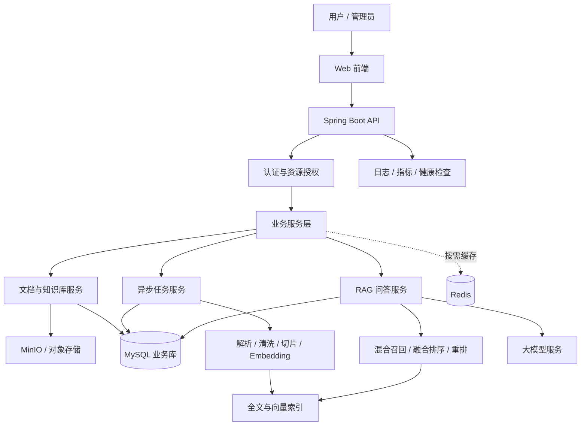

# Argus 企业级智能知识库平台（二次开发）技术方案

> 文档版本：V1.0  
> 项目定位：基于开源 Argus 知识库平台进行二次开发，打造面向企业研发团队的文档管理、智能检索与知识问答平台。  
> 方案原则：优先复用原项目稳定能力，围绕业务数据库迁移、文档处理可靠性、RAG 检索质量、权限隔离和工程化部署进行增量改造。  
> 注意：本文是目标方案和开发清单。具体原项目技术、目录、类名和现有功能，需以实际仓库源码审查结果为准；不得将计划中的功能写成已完成成果。

---

## 1. 项目目标与范围

### 1.1 项目目标

1. 将业务数据存储调整为 MySQL，统一用户、知识库、文档、任务和审计等业务数据管理。
2. 完善文档上传、解析、切片、向量化、索引和删除的全链路可靠性。
3. 提升 RAG 检索结果的相关性、可追溯性与无答案场景下的可靠性。
4. 实现知识库/文档级权限校验，防止跨用户或跨团队的数据越权访问。
5. 建立可复现的检索评测、自动化测试、日志监控和容器化部署流程。
6. 形成可独立演示、测试和维护的项目文档与交付流程。

### 1.2 项目边界

本项目以二次开发为主，不建议第一阶段推倒重写。先梳理原项目的模块、依赖、数据流和许可证，再按收益与风险安排修改。对于原项目已经实现的 RAG、混合检索、权限或流式输出能力，应先评估质量与边界，再决定是复用、补强还是替换。

### 1.3 业务场景

首选场景：**企业研发知识库**。支持研发团队管理技术文档、接口规范、部署手册、故障复盘和项目规范；用户可以上传资料、按权限检索、进行带引用的问答，并对低质量答案提交反馈。

---

## 2. 技术栈选型

以下为建议的目标技术栈，不代表原仓库已经采用所有组件。新增组件前应先检查现有实现，避免重复引入。

| 层次 | 选型 | 主要职责 | 选型说明 |
|---|---|---|---|
| 开发语言 | Java 21（以原项目兼容性为准） | 业务开发 | 若原项目 JDK 版本不同，先评估升级影响 |
| 后端框架 | Spring Boot 3.x（以原项目版本为准） | API、依赖注入、配置与业务组织 | 不为追求版本号而盲目升级 |
| 持久层 | MyBatis-Plus（若原项目采用其他 ORM，先评估迁移） | CRUD、分页、条件查询 | 复杂 SQL 可保留 XML/自定义 Mapper |
| 身份与授权 | Spring Security（复用原认证体系） | 登录认证、角色与资源权限 | 授权必须在服务端执行 |
| 业务数据库 | MySQL 8.0+ | 用户、团队、知识库、文档元数据、任务、反馈、审计 | 统一承载业务事务数据 |
| 全文检索 | Elasticsearch（优先复用现有检索引擎） | 关键词检索、过滤、排序 | 版本和映射设计需与原项目兼容 |
| 向量检索 | 优先评估 Elasticsearch 向量能力；若迁移成本过高，暂时保留 PostgreSQL + pgvector | Embedding 向量存储与相似度召回 | MySQL 迁移不等于向量存储自动迁移；按版本能力、数据量和查询要求决策 |
| 缓存 | Redis（按需） | 热点数据缓存、限流、短期状态 | 不缓存未经权限隔离的敏感检索结果 |
| 对象存储 | MinIO（或原项目已有存储） | 原始文件、解析产物与附件 | 配置访问策略、文件校验与生命周期 |
| AI 集成 | 沿用原项目模型接入层；必要时评估 Spring AI | LLM 调用、Embedding、流式输出 | 避免在未确认兼容性前整体替换模型适配层 |
| 异步任务 | Spring Task/线程池；有持久化队列需求时再引入 RabbitMQ | 文档解析、切片、向量化、索引任务 | 先实现任务状态、幂等与重试，再决定是否上消息队列 |
| 前端 | 沿用原项目前端；若需重构，可选 Vue 3 + TypeScript + Element Plus | 管理后台、文档管理、问答与运维界面 | 不把纯视觉重做作为主要技术成果 |
| 构建工具 | Maven（后端）及原项目已有前端包管理器 | 构建、依赖管理 | 锁定可复现版本 |
| 测试 | JUnit 5、Mockito；必要时 Testcontainers | 单元、集成和数据库测试 | 核心业务需有自动化回归测试 |
| 性能测试 | JMeter 或 Gatling | 并发、吞吐与延迟评估 | 记录环境、数据集与测试参数 |
| 部署 | Docker、Docker Compose | 本地开发、演示与部署 | 持久化卷、健康检查、环境变量与日志配置不可缺少 |
| 可观测性 | SLF4J/Logback、Actuator；必要时 Prometheus/Grafana | 日志、健康状态、指标 | 先记录关键指标，再扩展监控系统 |

### 2.1 MySQL 迁移原则

- MySQL 主要承载业务关系数据，不应默认承担原项目全部向量检索职责。
- 如果原项目使用 PostgreSQL + pgvector，迁移前要盘点向量表、距离计算、索引类型、专属 SQL、事务和数据迁移脚本。
- 推荐优先比较两条路线：
  - **路线 A：MySQL + Elasticsearch + MinIO**：当当前 Elasticsearch 版本和现有实现能满足向量召回、过滤和排序要求时采用，组件更少。
  - **路线 B：MySQL + PostgreSQL/pgvector + Elasticsearch + MinIO**：保留现有 pgvector 能力，迁移风险通常更可控，但要维护两种关系型数据库。
- 通过独立的检索接口/适配层隔离向量实现，避免业务 Service 直接耦合某个数据库的专属 SQL。
- 在数据迁移、双写/切换、回滚方案和检索回归测试准备好之前，不删除旧数据库与旧数据。

### 2.2 目标架构

**架构说明：**

1. 前端只负责展示和交互；所有身份、知识库和文档权限由后端校验。
2. 业务服务通过 Service 层组织业务规则，Mapper/Repository 层负责数据访问。
3. 文档 ETL 使用可追踪的任务状态和可恢复机制，不在 HTTP 请求中同步执行长时间处理。
4. 全文索引、向量索引和对象存储与 MySQL 业务库分开管理；跨系统一致性由幂等、重试、补偿和重建机制保证。
5. RAG 回答应保留检索证据与引用信息，并对低置信度或无证据场景进行拒答/澄清。

---

## 3. 目标模块划分

| 模块 | 主要职责 | 关键数据/能力 |
|---|---|---|
| 用户与团队 | 用户、团队、角色、成员关系 | 用户状态、角色、团队关系 |
| 知识库管理 | 创建、更新、归档、成员授权 | 知识库元数据、访问范围 |
| 文档管理 | 上传、下载、版本、删除 | 文件指纹、版本、存储地址、状态 |
| 文档 ETL | 解析、清洗、切片、Embedding、索引 | 任务状态、切片、错误信息 |
| 检索服务 | 关键词召回、向量召回、融合排序 | Top-K、过滤条件、排序分数 |
| RAG 问答 | 上下文组装、模型调用、引用返回 | 会话、问题、答案、引用证据 |
| 反馈与评测 | 点赞/点踩、测试集、离线评测 | 标准答案、相关文档、评测指标 |
| 审计与运维 | 操作日志、任务监控、异常查询 | 操作人、操作时间、任务耗时 |
| 部署与配置 | 环境配置、健康检查、启动脚本 | 环境变量、容器、卷、健康状态 |

---

## 4. 二次开发修改清单

优先级说明：P0 = 必须先做；P1 = 核心增强；P2 = 有余力再做。具体文件路径需在仓库审查后填写，禁止凭猜测创建或修改类名。

### 4.1 第一阶段：源码审查与可运行基线（P0）

- [ ] 阅读项目 README、许可证、目录结构与启动方式。
- [ ] 记录 Java/JDK、Spring Boot、前端框架、数据库、检索引擎和模型接入版本。
- [ ] 检查 Maven `pom.xml`、前端 `package.json`、配置文件、Docker 文件和数据库脚本。
- [ ] 在干净环境中启动原项目，记录启动步骤与已知问题。
- [ ] 跑通上传文档、处理完成、检索问答、文档删除的端到端流程。
- [ ] 绘制原项目模块图与文档处理时序图。
- [ ] 为关键流程建立基线测试和基础性能数据。
- [ ] 检查开源许可证与第三方依赖许可，保留必要的版权声明。

**交付物：** 源码审查记录、原始架构图、运行说明、基线测试报告。

### 4.2 第二阶段：MySQL 迁移（P0）

- [ ] 盘点所有 PostgreSQL 专属 SQL、数据类型、函数、索引和数据库扩展。
- [ ] 确认哪些表是业务数据，哪些表存储向量、全文索引或 ETL 中间结果。
- [ ] 新建 MySQL 数据库与最小权限账号，调整连接配置与 JDBC 依赖。
- [ ] 迁移业务表结构、索引、唯一约束、外键与初始化数据。
- [ ] 检查自增主键、时间类型、JSON 字段、分页、排序、事务和批量写入语法。
- [ ] 修改 Mapper/XML/Repository 中与 PostgreSQL 绑定的 SQL。
- [ ] 处理数据库迁移脚本与版本管理，避免依赖手工改库。
- [ ] 设计迁移前备份、数据校验、切换窗口和回滚流程。
- [ ] 验证业务查询、分页、并发写入、事务回滚和唯一约束。
- [ ] 对比迁移前后数据行数、关键字段与业务结果。
- [ ] 明确向量存储方案：保留 pgvector，或经评估后迁移到 Elasticsearch 等检索方案。
- [ ] 对向量召回、过滤、排序和引用进行回归测试。

**验收标准：** 业务核心流程在目标数据库中通过自动化测试；迁移数据可校验；向量检索方案明确且回归通过。

### 4.3 第三阶段：文档上传与 ETL 可靠性（P0）

- [ ] 增加文件大小、MIME 类型、扩展名及文件内容校验。
- [ ] 使用 SHA-256 等文件指纹识别重复文件，并明确同一文件在不同知识库下的处理规则。
- [ ] 为文档处理任务设计稳定任务 ID 与状态流转：`PENDING → PARSING → CHUNKING → INDEXING → SUCCESS/FAILED`。
- [ ] 记录任务开始/结束时间、耗时、重试次数、错误码和可读错误信息。
- [ ] 对重复请求实现幂等控制，避免重复切片、重复向量和重复索引。
- [ ] 为可恢复失败实现有上限的重试与退避策略，区分可重试和不可重试错误。
- [ ] 处理服务重启后遗留任务的恢复机制。
- [ ] 对数据库、对象存储、全文索引和向量索引之间的不一致提供补偿或重建能力。
- [ ] 文档删除时同步清理或标记所有相关索引，避免删除内容继续被召回。
- [ ] 将耗时解析与向量化放到后台任务中，限制线程池与并发度。
- [ ] 评估是否需要 RabbitMQ；只有当任务持久化、削峰、跨服务解耦等需求明确时才引入。

**验收标准：** 重复提交不会产生重复有效索引；任务失败可追踪、可重试；删除后不能再召回旧内容；服务重启后任务可按设计恢复。

### 4.4 第四阶段：RAG 检索质量（P1）

- [ ] 建立 50–100 条起步的评测问题集，覆盖事实、术语、跨段落、无答案和权限场景。
- [ ] 记录每条问题的标准答案、相关文档/片段及评测规则。
- [ ] 统一检索配置：切片长度、重叠长度、Top-K、过滤条件和分数阈值。
- [ ] 检查关键词检索与向量检索的召回结果，优化混合召回策略。
- [ ] 评估并调优 RRF 参数；若已有重排器，先比较效果，不重复造轮子。
- [ ] 在提示词中要求回答基于证据，并返回来源、文档名、版本和片段位置。
- [ ] 对证据不足、检索为空或引用不匹配的情况进行拒答或澄清。
- [ ] 记录检索结果、排序分数、模型版本和提示词版本，便于问题复现。
- [ ] 比较改造前后的 Recall@K、MRR、nDCG、回答正确率和引用准确率。

**验收标准：** 有可复现的评测集、基线和对比报告；任何“提升百分比”都必须来自真实测试数据。

### 4.5 第五阶段：权限与安全（P1）

- [ ] 梳理用户、团队、角色、知识库和文档的授权模型。
- [ ] 在服务端统一校验资源权限，不依赖前端隐藏按钮。
- [ ] 在关键词召回、向量召回、答案上下文、引用返回、下载和删除路径执行权限过滤。
- [ ] 增加跨用户、跨团队、越权下载和伪造资源 ID 的测试。
- [ ] 避免缓存未按用户/权限范围隔离的敏感数据。
- [ ] 对上传文件做类型、大小、恶意内容和路径安全检查。
- [ ] 将数据库密码、模型 API Key 等敏感配置放入环境变量或安全配置系统。
- [ ] 对关键管理操作记录审计日志。
- [ ] 检查提示词注入风险：文档内容作为不可信数据处理，不允许文档内容覆盖系统规则或授权策略。

**验收标准：** 无权用户不能通过搜索结果、答案引用、下载地址或接口参数访问未授权内容。

### 4.6 第六阶段：性能与可观测性（P1）

- [ ] 为高频业务查询建立慢 SQL 排查与索引优化流程。
- [ ] 使用分页与批量处理，避免一次性加载大量文档或切片。
- [ ] 仅对适合的数据使用 Redis 缓存，并设计过期、失效和权限隔离策略。
- [ ] 记录 API 响应时间、错误率、任务队列积压、ETL 耗时、检索耗时和模型耗时。
- [ ] 为日志增加请求 ID、任务 ID、文档 ID等关联字段，避免记录密钥或完整敏感内容。
- [ ] 为关键接口增加超时、限流和必要的熔断/降级。
- [ ] 使用 JMeter/Gatling 建立可重复的并发测试场景。
- [ ] 记录优化前后的 P50/P95/P99 延迟、吞吐量、错误率和资源占用。

**验收标准：** 有可复现的测试条件与结果；不以未经测量的数字描述性能提升。

### 4.7 第七阶段：测试、部署与文档（P1）

- [ ] 为文件指纹、任务状态、权限判断、检索过滤和删除补偿编写单元测试。
- [ ] 为 MySQL 访问、ETL 流程和问答链路编写集成测试。
- [ ] 为核心用户路径建立端到端回归用例。
- [ ] 提供 `.env.example`，不提交真实密钥。
- [ ] 编写 Docker Compose 部署配置和数据持久化卷。
- [ ] 配置服务健康检查、启动依赖、合理重启策略和日志输出。
- [ ] 编写从空环境启动、初始化数据库、导入演示文档到完成问答的 README。
- [ ] 准备脱敏演示数据和演示账号，明确账号权限。
- [ ] 记录架构决策、数据库迁移步骤、API 说明和常见故障排查。
- [ ] 检查新功能测试、许可证声明和第三方依赖清单。

**验收标准：** 按 README 能从空环境启动；关键测试通过；演示流程完整；仓库不包含真实密钥。

### 4.8 第八阶段：差异化功能（P2）

优先选择 1–2 项完成，不建议同时铺开。

- [ ] **文档版本管理：** 更新后保留版本历史，支持重新索引与版本回滚。
- [ ] **问答反馈闭环：** 点赞、点踩、错误原因标记、低质量问答列表。
- [ ] **RAG 调试面板：** 展示关键词召回、向量召回、RRF 排名、最终证据与引用。
- [ ] **检索评测中心：** 管理测试集，比较切片、Top-K、重排和模型参数。
- [ ] **ETL 运维面板：** 展示任务状态、失败原因、重试与处理耗时。
- [ ] **知识库使用统计：** 查询量、热门问题、无答案问题、文档处理成功率。

---

## 5. 建议的数据模型

以下为业务模型草案，需对照原项目已有表结构后合并，避免重复建表。

| 表/实体 | 主要字段建议 | 说明 |
|---|---|---|
| `sys_user` | `id`、`username`、`password_hash`、`status`、`created_at` | 用户基本信息；密码存储强哈希，不存明文 |
| `sys_role` | `id`、`role_code`、`role_name` | 角色 |
| `user_role` | `user_id`、`role_id` | 用户角色关系 |
| `knowledge_base` | `id`、`name`、`owner_id`、`status`、`created_at` | 知识库 |
| `knowledge_member` | `knowledge_base_id`、`user_id`、`permission` | 知识库成员授权 |
| `document` | `id`、`knowledge_base_id`、`name`、`file_hash`、`storage_key`、`version`、`status` | 文档元数据 |
| `document_task` | `id`、`document_id`、`task_type`、`status`、`retry_count`、`error_code`、`started_at`、`finished_at` | ETL 任务 |
| `document_chunk` | `id`、`document_id`、`version`、`chunk_index`、`content_hash`、`text`、`metadata` | 是否在 MySQL 存储切片正文需结合数据量和原实现决定；向量可独立存储 |
| `chat_session` | `id`、`user_id`、`knowledge_base_id`、`title`、`created_at` | 会话 |
| `chat_message` | `id`、`session_id`、`role`、`content`、`created_at` | 对话消息 |
| `answer_feedback` | `id`、`message_id`、`user_id`、`rating`、`reason`、`created_at` | 答案反馈 |
| `audit_log` | `id`、`actor_id`、`action`、`resource_type`、`resource_id`、`created_at` | 审计日志 |

**数据建模注意：**

- 表名、字段、主键类型、删除策略和审计字段要遵循原项目约定。
- 为高频过滤条件、外键关系、唯一业务键设计索引；索引应基于查询计划验证。
- 对文档版本、文件指纹和任务幂等键建立合适的唯一约束。
- 切片正文是否放 MySQL，需要结合体量、检索设计和数据保留策略决定。
- 不要将向量以不适合的方式直接塞入业务表；向量存储方案要独立评估。

---

## 6. 关键接口草案

实际接口路径需沿用原项目风格并检查是否已有同类接口。

| 方法 | 接口示例 | 说明 |
|---|---|---|
| `POST` | `/api/knowledge-bases` | 创建知识库 |
| `GET` | `/api/knowledge-bases` | 获取当前用户可访问的知识库 |
| `POST` | `/api/knowledge-bases/{id}/documents` | 上传文档并创建处理任务 |
| `GET` | `/api/documents/{id}` | 查看文档状态与元数据 |
| `GET` | `/api/document-tasks/{id}` | 查询 ETL 任务进度 |
| `POST` | `/api/document-tasks/{id}/retry` | 重试允许重试的任务 |
| `DELETE` | `/api/documents/{id}` | 删除文档并触发索引清理 |
| `POST` | `/api/knowledge-bases/{id}/search` | 检索测试/调试 |
| `POST` | `/api/knowledge-bases/{id}/chat` | 发起问答 |
| `POST` | `/api/chat-messages/{id}/feedback` | 提交回答反馈 |
| `GET` | `/api/admin/etl/tasks` | 管理员查看任务列表 |

接口需要统一处理参数校验、错误码、认证、授权、分页、超时和日志追踪。流式问答可沿用原项目的 SSE/WebFlux 等实现，不应仅为采用某种技术而改造。

---

## 7. 验收与评测计划

### 7.1 功能验收

- [ ] 用户只能访问授权知识库。
- [ ] 上传同一文件的重复请求按设计去重或生成独立版本。
- [ ] ETL 状态完整可追踪，失败任务能够查看原因并按策略重试。
- [ ] 文档删除后，全文与向量检索均不再返回该文档内容。
- [ ] 问答能返回可定位的来源引用。
- [ ] 无相关证据时按设计拒答或提示补充资料。
- [ ] 数据库迁移后关键业务数据与结果一致。
- [ ] Docker 环境可按 README 完成启动。

### 7.2 质量指标

| 类别 | 指标 | 使用方式 |
|---|---|---|
| 检索 | Recall@5、MRR、nDCG@10 | 对比基线与优化版本 |
| 生成 | 回答正确率、引用准确率、拒答准确率 | 通过人工标注或明确评分规则评估 |
| ETL | 成功率、平均耗时、失败重试成功率 | 使用固定文档集统计 |
| API | P50/P95/P99、吞吐量、错误率 | 使用固定并发、数据量和环境测试 |
| 安全 | 越权用例通过率 | 建立跨用户、跨团队访问测试 |
| 工程化 | 单元/集成测试通过率、部署成功率 | CI 或固定验收流程 |

所有结果必须记录测试日期、环境配置、数据集版本、并发参数和代码版本。没有实际测试的数据不得作为项目成果或简历数字。

---

## 8. 推荐实施顺序

1. **先运行原项目并梳理架构**：确认依赖、数据库、检索链路、权限和部署方式。
2. **明确 MySQL 迁移边界**：先迁移业务数据，单独决策向量与全文检索存储。
3. **完成 ETL 幂等与失败恢复**：优先解决最容易造成数据不一致的工程问题。
4. **完善权限校验**：覆盖检索、引用、下载、删除全链路。
5. **建立 RAG 评测集**：用指标验证检索与回答质量，而不是凭感觉调整。
6. **完成监控、测试与容器部署**：保证其他人能复现运行。
7. **挑选差异化功能**：建议先做文档版本管理或 RAG 调试/评测面板。

---

## 9. 风险与决策记录

| 风险 | 影响 | 应对措施 |
|---|---|---|
| 原项目依赖 PostgreSQL 专属能力 | MySQL 切换后 SQL 或向量链路失效 | 先审计依赖；业务库和向量库分开迁移 |
| 全文与向量索引和业务库不一致 | 文档删除后仍被检索，或索引缺失 | 幂等任务、重试、补偿、索引重建 |
| 引入过多新组件 | 部署复杂、调试成本增加 | 每个组件必须对应明确需求 |
| 未建立基线就宣称优化 | 结果不可验证 | 先固定测试集与指标，再做前后对比 |
| 只改 UI 和项目名 | 技术贡献不明显 | 优先提交可测试的后端功能和工程改造 |
| 误将开源成果写成原创 | 许可与诚信风险 | 保留版权声明，明确二次开发范围与实际贡献 |

### 决策原则

- 优先复用已经稳定的功能，不为技术名词重写系统。
- 先有测试与指标，再做性能优化。
- 数据库迁移必须可验证、可回滚。
- 所有权限过滤必须由后端执行。
- 只有实际实现、测试通过的功能才能标记为“已完成”。

---

## 10. 最终交付清单

- [ ] 源码审查与架构说明
- [ ] 技术栈与架构决策记录
- [ ] MySQL 迁移脚本、数据校验脚本及回滚说明
- [ ] 文档 ETL 状态机、幂等与重试实现
- [ ] 检索评测数据集与前后对比报告
- [ ] 权限安全测试用例
- [ ] 自动化测试与性能测试报告
- [ ] Docker Compose、环境变量示例和启动说明
- [ ] API 文档、ER 图、关键流程图
- [ ] 演示数据、演示流程和已知问题列表
- [ ] 开源许可证与第三方依赖声明

> **项目完成标准：** 不以“代码能启动”作为唯一标准。至少应做到核心业务可运行、数据库迁移可验证、文档任务可恢复、权限边界可测试、RAG 质量可评估、部署步骤可复现。
